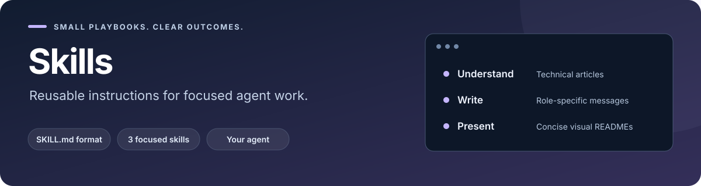
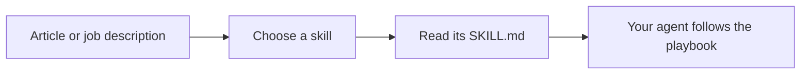

<p align="center"></p>

<p align="center">
  
  
</p>

Two focused agent skills: **understand technical articles** and **write grounded job-application messages**. Each is a readable Markdown playbook in its own folder.

## Pick a skill

| Skill | What it does |
| --- | --- |
| [Understand technical articles](Understand-technical-articles/SKILL.md) | Explains a technical article through eight questions, then helps you explore a chosen topic more deeply. |
| [Job application message](job-application-message/SKILL.md) | Writes an 80–120-word hiring-team message connecting a specific role to relevant, verified experience. |



## Use

```sh
git clone https://github.com/nerdynaman/skills.git
cd skills
```

Point your agent at the skill’s `SKILL.md`, or copy its folder into the skill directory your agent supports. Example prompts:

> Read `Understand-technical-articles/SKILL.md` and use it to explain this article: [link].

> Read `job-application-message/SKILL.md` and draft a message for this job description: [text].

**Personalize before reuse:** the job-message skill contains the author’s background. Replace it with your own verified experience before drafting applications.

## What to expect

- Article explanations cover the problem, main idea, mechanism, prerequisites, choices, trade-offs, evidence and applications.
- Application messages use role-specific details and avoid invented experience or generic company praise.
- These are instructions for your agent, not a standalone application. Link access depends on the tools your agent has available.
